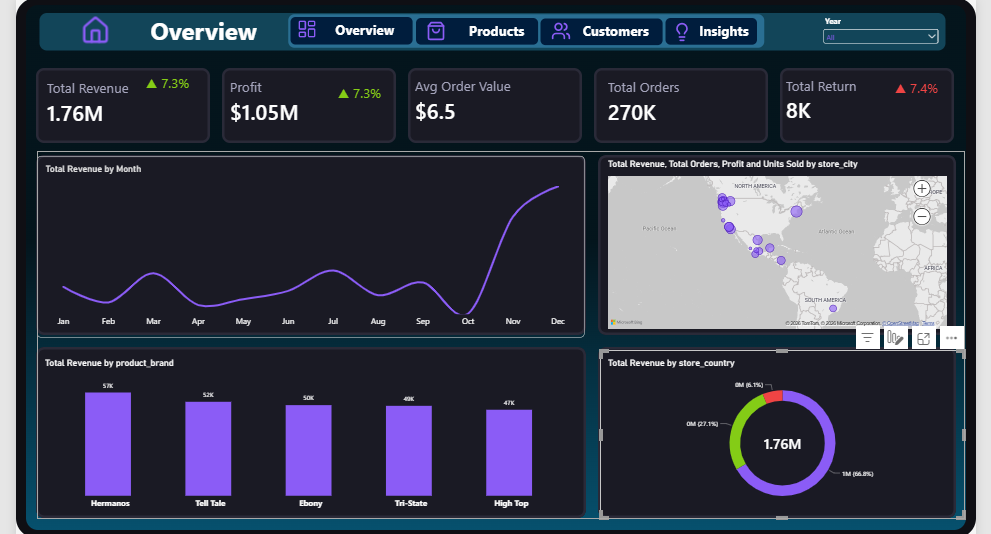

# Retail Sales Analysis Dashboard

An interactive, 5-page Power BI dashboard that analyzes retail sales performance across the USA, Mexico and Canada (1997–1998). It covers revenue, products, customers, and ends with data-backed recommendations for management.



## Business questions
- How are revenue, profit and orders performing, and how do they change month over month?
- Which markets, store types and brands drive revenue?
- Where do returns hurt profitability?
- Who are the customers, and where are they?
- What should management do next?

## Key findings
- **$1.76M revenue** and **$1.05M profit** (about 60% margin) from **270K orders**; average order value is **$6.50**.
- **USA drives 67% of revenue** ($1.18M), followed by Mexico ($479K) and Canada ($108K).
- **Supermarkets** are the top store type ($789K); **Small Grocery** is the weakest ($34K).
- **Hermanos** is the top brand by revenue and units sold.
- **Sales peak in November–December**, which points to strong seasonal demand.
- **Central West** is the weakest region ($9.3K), and about **8K returns** reduce profitability.
- **10,281 customers**: 72% in the USA, 17% in Canada, 12% in Mexico.

## Dashboard pages
| Page | What it shows |
|---|---|
| Home | Landing page with navigation to every section |
| Overview | KPI cards with month-over-month change, monthly trend, map, revenue by brand and country |
| Products | Units sold, average price, top brand, returns by brand and store type, revenue by brand |
| Customers | Customer count by city, state and country, revenue by membership card |
| Insights | Key findings and four management recommendations |

## Recommendations
1. Increase inventory in Supermarket stores, which generate the highest revenue.
2. Focus marketing on Central West to improve its sales performance.
3. Review high-return products to reduce returns and protect profit.
4. Prepare inventory and promotions for November and December, when sales peak.

## Screenshots
| | |
|---|---|
|  |  |
|  |  |

## Tools and skills
- **Power BI**: data modeling, interactive visuals, buttons, bookmarks, page navigation
- **DAX**: month-over-month and year-over-year measures, conditional formatting, Top N logic
- **Power Query**: data cleaning and shaping
- **Figma**: dark-theme layout and page backgrounds

## Project structure
```
Retail-Sales-Dashboard/
├── README.md
├── dashboard/        # Power BI file (.pbix)
├── presentation/     # Project presentation (PDF)
└── screenshots/      # Page previews
```

## How to use
1. Download the `.pbix` file from the `dashboard` folder.
2. Open it with Power BI Desktop.
3. Use the Year slicer and the navigation buttons to explore each page.

## Notes
- The data covers 1997–1998 and is used for learning and portfolio purposes.
- Personal customer fields are not included in this repository.

## Author
**Habiba Mostafa**: Business Information Systems student and aspiring Data Analyst
[LinkedIn](https://www.linkedin.com/in/your-profile) · [GitHub](https://github.com/your-username)
